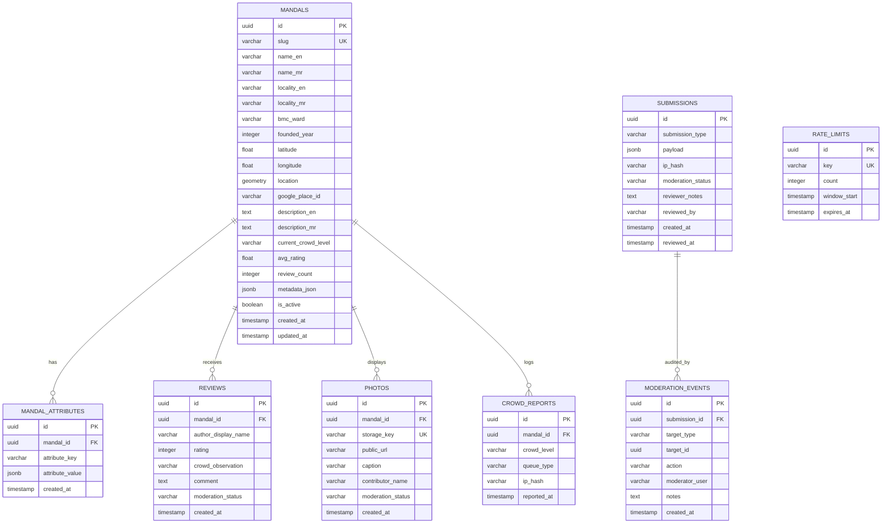

# Database Schema & Data Modeling

## Document Details

- **Project:** BappaMap Mumbai
- **Database Engine:** PostgreSQL 15+ with PostGIS 3.3+ extension (Production: PostgreSQL 16 + PostGIS 3.6)
- **Spatial Reference System:** WGS 84 (SRID 4326)
- **ORM & Migrations:** SQLAlchemy 2.0 (asyncio + asyncpg) & Alembic
- **Status:** Approved Specification

---

## 1. Schema Design Principles

1. **Native Geospatial Precision:** Coordinates are stored using PostGIS `geometry(Point, 4326)`. This allows accurate distance calculations (`ST_Distance`, `ST_DWithin`) in meters and bounding box queries (`ST_MakeEnvelope`) with native spatial GiST indexes.
2. **Extensible Attribute Model:** Future filter parameters (such as `prasad_distributed`, `wheelchair_accessible`, `live_stream_available`, `queue_time_estimate`) are stored in an extensible key-value attribute table (`mandal_attributes`) and an indexed `metadata_json` column.
3. **Queue-Aware Crowd Intelligence:** Crowd reports support distinct queue categories (`mukh_darshan` vs `charan_sparsh`), enabling precise darshan wait estimates.
4. **Strict Moderation State Machine & Auditability:** All community submissions include an immutable audit trail (`moderation_events`) and explicit quarantine states (`pending`, `published`, `flagged`, `rejected`).
5. **DPDP Act Compliant Rate Limiting:** Persistent client rate limiting (`rate_limits`) indexes HMAC-SHA256 salted IP hashes rather than plain-text IP addresses.

---

## 2. Entity Relationship Diagram



---

## 3. Core Tables Specification

### 3.1 `mandals` Table

Stores verified and approved Ganpati mandals in South Mumbai.

| Column | Type | Constraints | Description |
| :--- | :--- | :--- | :--- |
| `id` | `UUID` | `PRIMARY KEY DEFAULT gen_random_uuid()` | Unique identifier |
| `slug` | `VARCHAR(100)` | `UNIQUE NOT NULL` | URL-safe slug (e.g. `lalbaugcha-raja`) |
| `name_en` | `VARCHAR(255)` | `NOT NULL` | Name in English |
| `name_mr` | `VARCHAR(255)` | `NOT NULL` | Name in Marathi (Devanagari) |
| `locality_en` | `VARCHAR(100)` | `NOT NULL` | Locality in English (e.g. `Lalbaug`) |
| `locality_mr` | `VARCHAR(100)` | `NOT NULL` | Locality in Marathi (e.g. `लालबाग`) |
| `bmc_ward` | `VARCHAR(10)` | `NOT NULL` | BMC Ward (`A`, `B`, `C`, `D`, `E`, `F/South`) |
| `founded_year` | `INTEGER` | `NULL` | Year established (e.g. 1893) |
| `latitude` | `FLOAT` | `NOT NULL` | Latitude coordinate |
| `longitude` | `FLOAT` | `NOT NULL` | Longitude coordinate |
| `location` | `GEOMETRY(Point, 4326)` | `NULL` | PostGIS spatial point for GiST indexing |
| `google_place_id` | `VARCHAR(255)` | `NULL` | Optional Google Maps Place ID |
| `description_en` | `TEXT` | `NULL` | Historical overview (English) |
| `description_mr` | `TEXT` | `NULL` | Historical overview (Marathi) |
| `current_crowd_level` | `VARCHAR(20)` | `DEFAULT 'low' NOT NULL` | Live calculated crowd tier |
| `avg_rating` | `FLOAT` | `DEFAULT 0.0 NOT NULL` | Aggregated star rating (1.0 to 5.0) |
| `review_count` | `INTEGER` | `DEFAULT 0 NOT NULL` | Total approved reviews count |
| `metadata_json` | `JSONB` | `DEFAULT '{}' NOT NULL` | Extensible key-value attributes |
| `is_active` | `BOOLEAN` | `DEFAULT true NOT NULL` | Active visibility flag |
| `created_at` | `TIMESTAMPTZ` | `DEFAULT NOW() NOT NULL` | Creation timestamp |
| `updated_at` | `TIMESTAMPTZ` | `DEFAULT NOW() NOT NULL` | Last update timestamp |

---

### 3.2 `crowd_reports` Table

Stores live queue observations logged by devotees, categorized by queue type.

| Column | Type | Constraints | Description |
| :--- | :--- | :--- | :--- |
| `id` | `UUID` | `PRIMARY KEY DEFAULT gen_random_uuid()` | Unique report ID |
| `mandal_id` | `UUID` | `NOT NULL REFERENCES mandals(id) ON DELETE CASCADE` | Associated mandal |
| `crowd_level` | `VARCHAR(20)` | `NOT NULL` | Observation tier (`low`, `moderate`, `heavy`, `very_heavy`) |
| `queue_type` | `VARCHAR(30)` | `NOT NULL` | Queue category (`mukh_darshan` or `charan_sparsh`) |
| `ip_hash` | `VARCHAR(64)` | `NOT NULL` | DPDP-salted HMAC-SHA256 IP hash |
| `reported_at` | `TIMESTAMPTZ` | `DEFAULT NOW() NOT NULL` | Observation timestamp |

---

### 3.3 `photos` Table

Stores approved and quarantined photos hosted on storage volumes or Cloudflare R2.

| Column | Type | Constraints | Description |
| :--- | :--- | :--- | :--- |
| `id` | `UUID` | `PRIMARY KEY DEFAULT gen_random_uuid()` | Unique photo ID |
| `mandal_id` | `UUID` | `NOT NULL REFERENCES mandals(id) ON DELETE CASCADE` | Associated mandal |
| `storage_key` | `VARCHAR(255)` | `UNIQUE NOT NULL` | File key in storage partition |
| `public_url` | `VARCHAR(500)` | `NOT NULL` | Accessible URL path for CDN delivery |
| `caption` | `VARCHAR(255)` | `NULL` | Optional caption |
| `contributor_name` | `VARCHAR(100)` | `DEFAULT 'Devotee' NOT NULL` | Contributor display credit |
| `moderation_status` | `VARCHAR(20)` | `DEFAULT 'pending' NOT NULL` | Quarantine status (`pending`, `published`, `rejected`) |
| `created_at` | `TIMESTAMPTZ` | `DEFAULT NOW() NOT NULL` | Upload timestamp |

---

### 3.4 `submissions` Table (Quarantine Inbox)

Universal intake for community suggestions (new mandals, reviews, or photo submissions).

| Column | Type | Constraints | Description |
| :--- | :--- | :--- | :--- |
| `id` | `UUID` | `PRIMARY KEY DEFAULT gen_random_uuid()` | Unique submission ID |
| `submission_type` | `VARCHAR(50)` | `NOT NULL` | Type (`new_mandal`, `review`, `photo`) |
| `payload` | `JSONB` | `NOT NULL` | Structured input payload |
| `ip_hash` | `VARCHAR(64)` | `NOT NULL` | DPDP-salted IP hash |
| `moderation_status` | `VARCHAR(20)` | `DEFAULT 'pending' NOT NULL` | Status (`pending`, `published`, `flagged`, `rejected`) |
| `reviewer_notes` | `TEXT` | `NULL` | Moderator commentary |
| `reviewed_by` | `VARCHAR(100)` | `NULL` | Moderator username |
| `created_at` | `TIMESTAMPTZ` | `DEFAULT NOW() NOT NULL` | Submission timestamp |
| `reviewed_at` | `TIMESTAMPTZ` | `NULL` | Moderation resolution timestamp |

---

### 3.5 `moderation_events` Table (Audit Trail)

Immutable audit log recording every administrative moderation action.

| Column | Type | Constraints | Description |
| :--- | :--- | :--- | :--- |
| `id` | `UUID` | `PRIMARY KEY DEFAULT gen_random_uuid()` | Unique audit event ID |
| `submission_id` | `UUID` | `NULL` | Associated submission ID |
| `target_type` | `VARCHAR(50)` | `NOT NULL` | Target entity (`submission`, `photo`, `mandal`, `review`) |
| `target_id` | `UUID` | `NULL` | Target entity ID |
| `action` | `VARCHAR(50)` | `NOT NULL` | Action performed (`approve`, `reject`, `flag`) |
| `moderator_user` | `VARCHAR(100)` | `NOT NULL` | Authenticated moderator username |
| `notes` | `TEXT` | `NULL` | Audit rationale / notes |
| `created_at` | `TIMESTAMPTZ` | `DEFAULT NOW() NOT NULL` | Event timestamp |

---

### 3.6 `rate_limits` Table (Persistent DPDP Token Bucket)

Persistent rate limiting tracking request quotas per salted client identifier.

| Column | Type | Constraints | Description |
| :--- | :--- | :--- | :--- |
| `id` | `UUID` | `PRIMARY KEY DEFAULT gen_random_uuid()` | Unique record ID |
| `key` | `VARCHAR(255)` | `UNIQUE NOT NULL` | Rate limit bucket key (`{ip_hash}:{endpoint}`) |
| `count` | `INTEGER` | `DEFAULT 1 NOT NULL` | Request count within window |
| `window_start` | `TIMESTAMPTZ` | `DEFAULT NOW() NOT NULL` | Window commencement timestamp |
| `expires_at` | `TIMESTAMPTZ` | `NOT NULL` | Bucket expiration timestamp |

---

## 4. Spatial Indexes & Query Optimization

```sql
-- PostGIS GiST spatial indexing for high-speed spatial containment and radius queries
CREATE INDEX idx_mandals_location ON mandals USING GIST (location);

-- B-tree indexes for fast lookups and state filtering
CREATE INDEX ix_mandals_slug ON mandals (slug);
CREATE INDEX ix_mandals_is_active ON mandals (is_active);
CREATE INDEX ix_reviews_mandal_id ON reviews (mandal_id);
CREATE INDEX ix_reviews_moderation_status ON reviews (moderation_status);
CREATE INDEX ix_photos_mandal_id ON photos (mandal_id);
CREATE INDEX ix_photos_moderation_status ON photos (moderation_status);
CREATE INDEX ix_crowd_reports_mandal_id ON crowd_reports (mandal_id);
CREATE INDEX ix_crowd_reports_reported_at ON crowd_reports (reported_at);
CREATE INDEX ix_submissions_moderation_status ON submissions (moderation_status);
CREATE INDEX ix_rate_limits_key ON rate_limits (key);
CREATE INDEX ix_rate_limits_expires_at ON rate_limits (expires_at);
```

---

## 5. Seed Strategy & Verification

Seed data is maintained in `data/seed-mandals.json` and inserted idempotently via `python backend/scripts/seed.py`. The baseline dataset contains 12 iconic South Mumbai mandals with historical provenance verified against MCGM records, plus any approved additions.

---

## 6. Document Cross-References

- [02-architecture.md](docs/02-architecture.md) — System request flow and storage layers.
- [04-backend-prd.md](docs/04-backend-prd.md) — API payloads and database queries.
- [07-content-and-data.md](docs/07-content-and-data.md) — Verified coordinates and founding details.
- [08-trust-and-safety.md](docs/08-trust-and-safety.md) — Moderation status transitions and audit logging.

