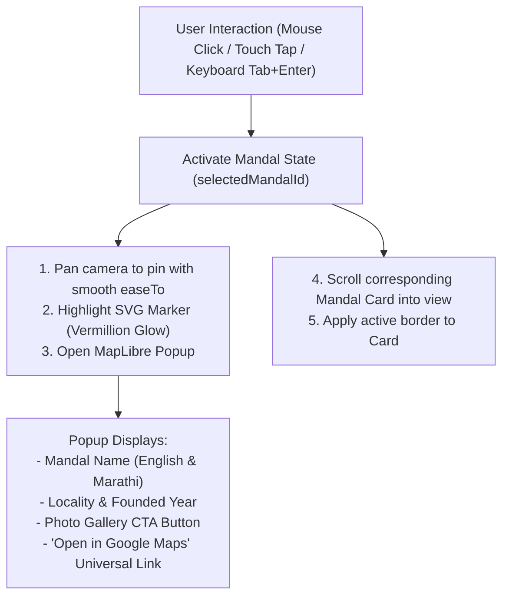

# Frontend Architecture & UI Specification

## Document Details

- **Project:** BappaMap Mumbai
- **Framework:** Next.js 15 (App Router, Static First) with React Islands
- **Styling:** Tailwind CSS with CSS Variables & Festive UI Accents
- **Map Renderer:** MapLibre GL JS (v5.x)
- **Status:** Approved Specification (Production Implementation)

---

## 1. Application Routing & Page Structure

The application is structured for instant edge delivery and zero client bundle bloat:

| Route | Purpose | Rendering Strategy | Key Components |
| :--- | :--- | :--- | :--- |
| `/` | Main interactive view: Map, Filter drawer, Mandal cards | SSG + ISR (300s) with Client Map Island | `MapContainer`, `FilterBar`, `MandalCardList`, `MandalExplorer`, `ContributionModal`, `MandalGalleryModal` |
| `/admin` | Maintainer moderation portal | Client-side authenticated (Argon2 session) | `AdminQueueTable`, `PhotoInspectionModal`, `AuditLogView` |
| `/admin/login` | Secure moderator authentication portal | Client-side authenticated | `LoginForm`, `SessionGuard` |

---

## 2. Interactive Map Behavior Specification

### 2.1 Geographic Bounds & Restrictions

- **Center Coordinate:** `[72.8250, 18.9550]` (Girgaon / Khetwadi centroid)
- **Default Zoom:** `13.5`
- **Zoom Constraints:** `minZoom: 12.0`, `maxZoom: 17.5`
- **Max Bounding Box (`maxBounds`):**
  ```typescript
  export const SOUTH_MUMBAI_BOUNDS: [[number, number], [number, number]] = [
      [72.78, 18.89], // Southwest (Colaba coast)
      [72.87, 19.015] // Northeast (Parel / Lalbaug boundary)
  ];
  ```
  _Constraint Enforcement:_ Users cannot pan or zoom outside these coordinates. Any attempt to pan beyond snaps back smoothly with dampening.

### 2.2 Geolocation Ban

- `GeolocateControl` is **never instantiated or imported**.
- The UI contains no "Find Me", "Current Location", or GPS icon.
- Automated CI test fails if `navigator.geolocation` is referenced.

### 2.3 Pin & Popup Interaction (Parity Rule)

A pin interaction renders identical content and triggers the same state transition across all interaction modalities:



#### Universal Google Maps Link Format:
```typescript
export function getGoogleMapsUrl(latitude: number, longitude: number): string {
    return `https://www.google.com/maps/search/?api=1&query=${encodeURIComponent(
        `${latitude},${longitude}`
    )}`;
}
```

---

## 3. Extensible Filter System & Bidirectional Synchronization

### 3.1 Bidirectional State Synchronization

1. **URL as Single Source of Truth:** Filter parameters live directly in URL search params (e.g. `/?crowd=low,moderate&parking=true&rating=4`).
2. **Filtering List Filters Pins:** When a user toggles "Low Crowd", only mandals matching the criteria remain visible in the card list AND on the map.
3. **Selecting Card Focuses Pin:** Tapping or clicking a card centers the map on the pin with smooth animation and opens its popup.

### 3.2 Extensible Filter Architecture

Filters are declared declaratively via `REGISTERED_FILTERS` in `src/lib/filters/definitions.ts`:
- **Crowd Level:** `low`, `moderate`, `heavy`, `very_heavy`
- **Parking Nearby:** boolean flag
- **Minimum Rating:** 1 to 5 stars

---

## 4. Community Contribution Modals & Privacy Pre-Flight

### 4.1 Contribution Modal Flow
The header houses a primary CTA button: **"Add / Review Mandal"** (`मंडळ जोडा / अभिप्राय द्या`), opening three distinct workflows:
1. **Suggest a New Mandal (`SuggestMandalForm.tsx`):**
   - Includes real-time **Auto-Marathi Transliteration**: as the contributor types English names or localities, a debounced call queries `/api/transliterate` and populates the Marathi field. If the user edits the Marathi field manually, the user-override is preserved.
2. **Submit a Review (`ReviewMandalForm.tsx`):**
   - Allows rating (1 to 5 stars), crowd observation, and darshan notes.
3. **Upload Mandal Photos (`UploadPhotoForm.tsx`):**
   - In-browser HTML5 Canvas EXIF/GPS stripping re-encodes photos as WebP (< 1600px, 0.82 quality) before uploading.

### 4.2 Community Photo Gallery Modal (`MandalGalleryModal.tsx`)
- Triggered by clicking the **"Photos (N)"** badge on any `MandalCard` or popup button.
- Displays responsive thumbnail grids, contributor credits, and full-screen lightbox viewing with keyboard navigation (`Esc`, `ArrowLeft`, `ArrowRight`).
- Updates live when an admin approves new photos via Server-Sent Events.

---

## 5. Live Server-Sent Events (SSE) Streaming

The core explorer (`MandalExplorer.tsx`) initiates an `EventSource` connection to `/api/events`:
- Automatically reflects approved community mandals (`mandal_approved`).
- Updates photo badges and gallery modal state when photos are approved (`photo_approved`).
- Updates crowd indicator meters in real time without browser reloads (`crowd_decay_updated`).

---

## 6. Accessibility (WCAG 2.2 AA Compliance)

1. **Focus Management:** Every pin marker is an accessible `<button>` element with `tabindex="0"`, explicit `aria-label`, and high-contrast focus rings.
2. **Keyboard Traversal:** Users can cycle through pins using `Tab` and activate details with `Enter` or `Space`.
3. **Contrast Ratio:** Text elements adhere to WCAG AA minimum 4.5:1 for body copy and 3.0:1 for large headers.
4. **Motion Safety:** All animations respect `@media (prefers-reduced-motion: reduce)`.

---

## 7. Performance Budgets

| Asset Category | Target Budget | Enforcement |
| :--- | :--- | :--- |
| **Initial HTML** | < 30 kB | Static generation in Next.js |
| **Critical CSS** | < 25 kB | Tailwind CSS extraction |
| **Client JS (Excluding Map)** | < 80 kB gzipped | Tree-shaken React components |
| **MapLibre GL JS + Worker** | < 280 kB gzipped | Lazy-loaded on idle / visibility |
| **Web Fonts (Devanagari + Latin)** | < 50 kB | WOFF2 with `unicode-range` subsetting |
| **Largest Contentful Paint (LCP)** | < 2.0s on 4G | Lighthouse CI automated run |
| **Cumulative Layout Shift (CLS)** | < 0.05 | Fixed aspect ratios on map and card slots |

---

## 8. Document Cross-References

- [01-PRD.md](docs/01-PRD.md) — Product vision and requirements.
- [04-backend-prd.md](docs/04-backend-prd.md) — Backend API schemas.
- [06-design-system.md](docs/06-design-system.md) — Visual design tokens and typography.
- [10-testing-and-qa.md](docs/10-testing-and-qa.md) — Playwright E2E and Axe accessibility tests.

